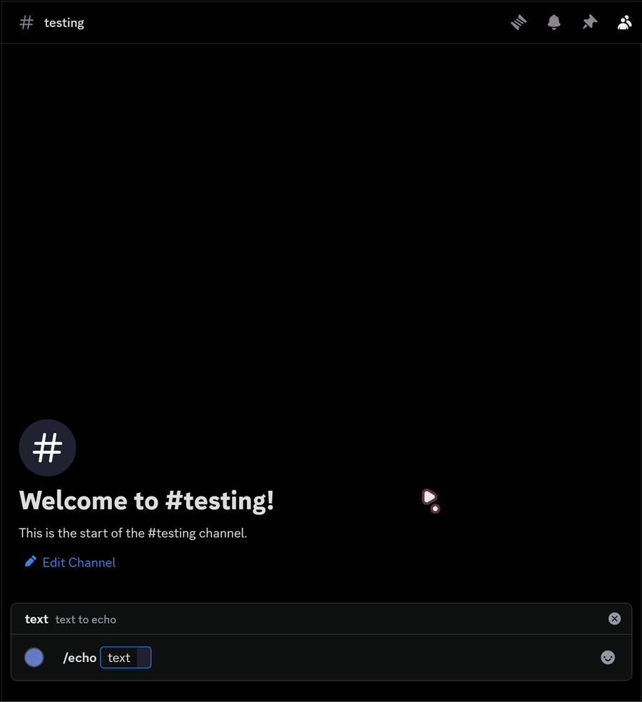
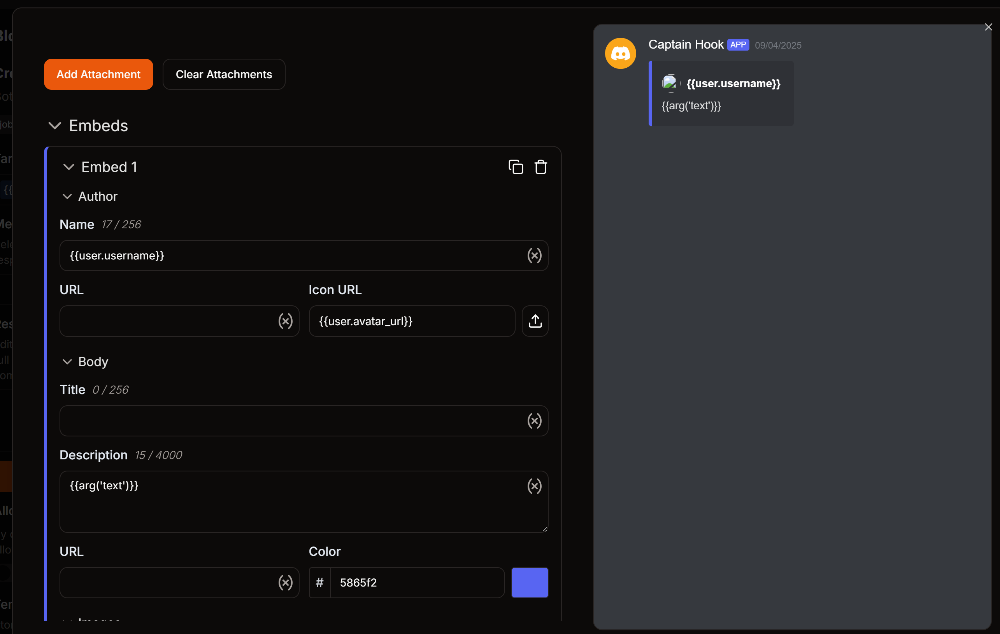
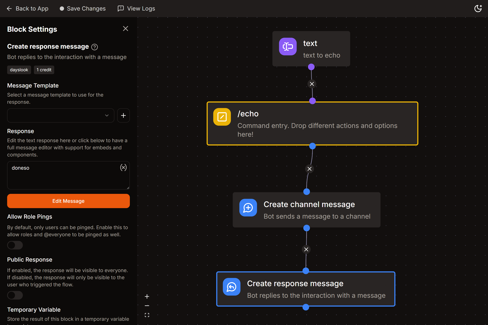

import EmbedFlowNode from "../../src/components/EmbedFlowNode";

# Beginner - Echo Command

A simple echo command that repeats your text to get new users started with the basic structure and features of the command builder.

## 🌟 Creating your command 
- Go to the commands section of your Kite dashboard and make a command with the name echo.

## 📝 Adding arguments
- Now that you've created your command, go to the `Options` section of your command builder and select the **Command Arguments** block.  
  <EmbedFlowNode type="option_command_argument" />  
- Connect this block to the little purple dot of your command name.
- Inside the **Command Arguments** block settings, add these:
        - **Name** - `text`
        - **Description** - `text to echo`
        - **Argument Type** - Text
        - **Argument Required** - True

:::note
Argument names can only be in lowercase and can't contain any special characters except an underscore (\_).  
If you want to add a space in an argument's name, use the underscore ( \_ ).
:::

## 💬 Sending message 
- From the actions menu, select the **Create Channel Message** block.  
  <EmbedFlowNode type="action_message_create" />  
- Set the target channel as `{{channel.id}}`
- Click **Edit Message** and then **Add embed**
        - In the description box, put `{{arg('text')}}`
        - For the Author section, put `{{user.username}}` in the name field and `{{user.avatar_url}}` in the Icon URL field.
- Exit the message editor.

## ✏️ Acknowledging your command 
:::info
Discord requires interactions (slash commands, modals & buttons) to compulsorily have a "response" otherwise, it shows a red alert on your screen saying "This interaction failed." even if your command works as expected. To prevent this, we use the **Create Response** block.
:::

- Add the **Create Response Message** block after the previous block.  
  <EmbedFlowNode type="action_response_create" />  
- In the response field, type anything acknowledging that the user's command is successful. (for eg. "doneso")
- Scroll down on the block settings, and turn off the "Public Response" to make it visible only to the user who ran the command.

## 💌 Save your command
- Click **Save Changes** at the top of your page. Kite adds the command to Discord a few seconds later.
- Voilà! You've created your first command.
- Refresh your Discord client and run the command in your server.

:::tip 
You can add the **Command Permissions** block alongside your arguments block to restrict command usage to users with certain permissions.
:::
