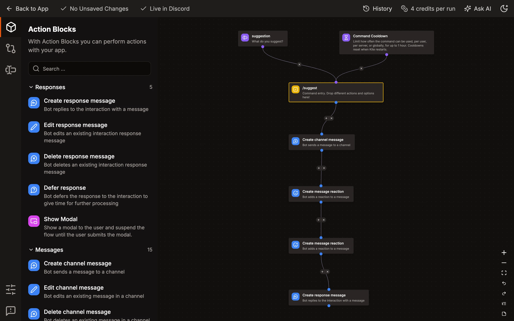
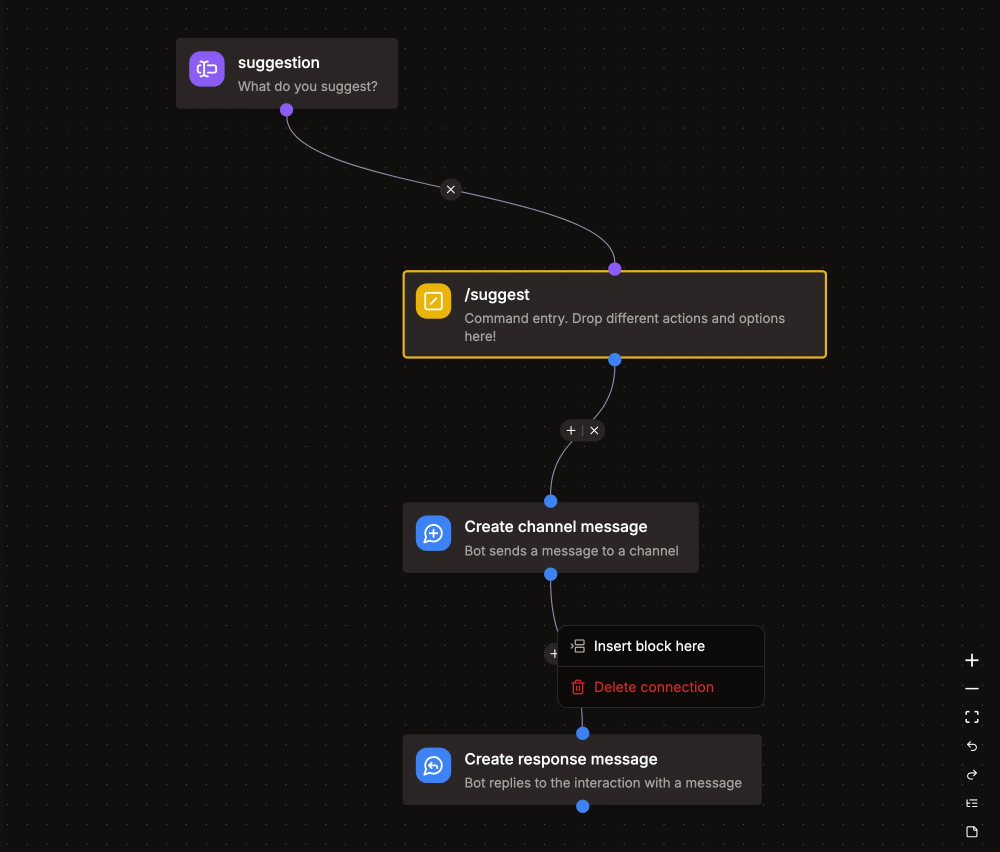

# Using the Flow Editor

Commands, event listeners and buttons are flows of blocks, which you build in the editor. Click on `Save Changes` to save a command or event listener. The flow of a button is saved with its message.

## Adding and connecting blocks

Drag a block from the block explorer on the left onto the canvas, or click on it to add it in the middle of what you're looking at. On mobile, tap `Add Block` in the bar at the bottom.

To connect two blocks, drag from the dot at the bottom of one block to the other block. A block runs after the block connected above it. To remove a connection, click on the `x` in its middle.

To add a block between two connected blocks, click on the `+` in the middle of the connection, or right click it and pick _Insert block here_. The connection then goes through the new block, and the blocks below move down to make room.

## Selecting and editing blocks

Click on a block to open its settings. Blocks with a problem, like a missing setting, have a red `!` on them.

Hold `Shift` and drag over the canvas to select several blocks. Drag one of them to move them all.

Right click a block or a selection for _Copy_, _Cut_, _Duplicate_ and _Delete_. Right click the canvas to paste, add a [note](../reference/notes.md), undo, redo, auto arrange the blocks or fit them to the view. On mobile, press and hold a block, a connection or the canvas to open its menu. The bar at the bottom also has undo, redo, auto arrange, fit to view and add note.

## Copy and paste

Copied blocks go to your clipboard, so you can paste them into another command, event listener or button, even in another app. They're pasted where your mouse is, or on mobile where you pressed. Blocks that aren't available where you paste them, like command options in an event listener, are left out.

## Keyboard shortcuts

On a Mac, use `Cmd` instead of `Ctrl`.

| Shortcut                               | Action                     |
| -------------------------------------- | -------------------------- |
| `Ctrl+C`                               | Copy the selected blocks   |
| `Ctrl+X`                               | Cut the selected blocks    |
| `Ctrl+V`                               | Paste at the mouse         |
| `Delete` or `Backspace`                | Delete the selected blocks |
| `Ctrl+Z`                               | Undo                       |
| `Ctrl+Shift+Z`, or `Ctrl+Y` on Windows | Redo                       |
| `Shift` and drag                       | Select several blocks      |

Undo and redo go through your recent changes to the flow, including the changes of the [Flow AI](./flow-ai.md). While you type in a setting, they undo your typing instead.

## Layout

The buttons at the bottom right zoom, fit the flow to the view, undo, redo, auto arrange and add a note. Auto arrange puts the blocks in a tree from top to bottom, with the branches of each block in the order of its outputs. The editor remembers where you were in each flow and goes back there next time.
