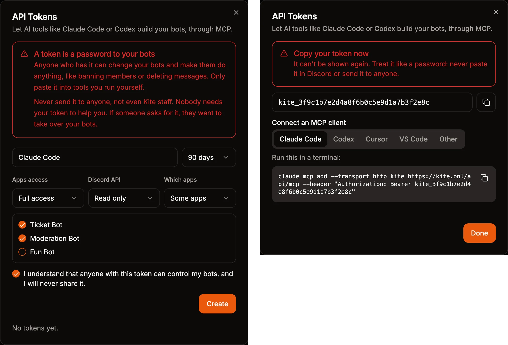
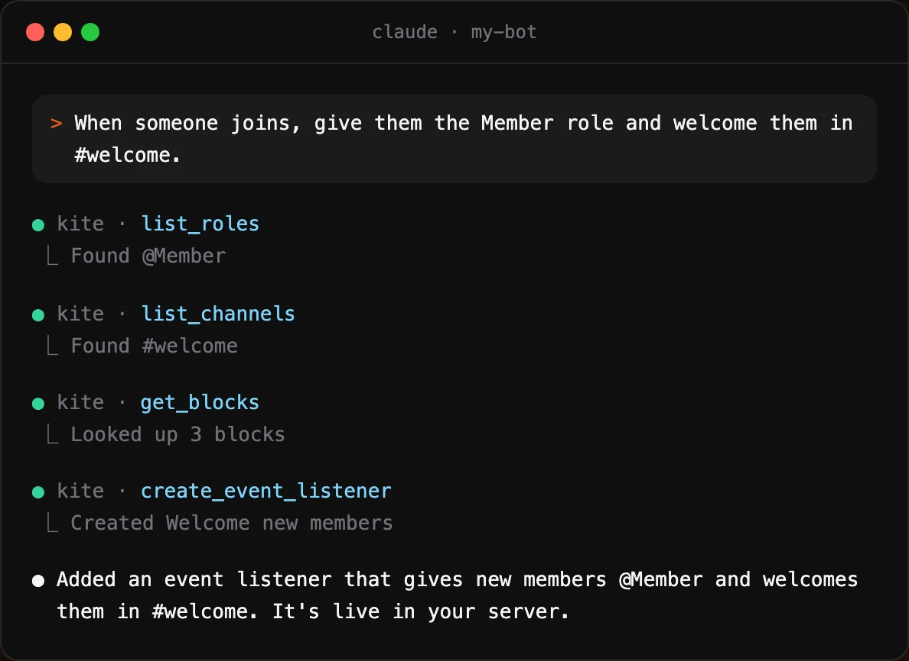

import Tabs from "@theme/Tabs";
import TabItem from "@theme/TabItem";

# Building with AI Clients (MCP)

Kite is an MCP server, so AI clients like Claude, ChatGPT, Claude Code and Codex can read and build your apps. You describe what your bot should do in the client, and it creates the commands, event listeners and message templates for you. It can also look at your logs to find out why a flow failed, and fix it.

The client uses its own AI model, so this doesn't use [flow AI](./flow-ai.md) prompts or [credits](../reference/credit-system.md). The flows it builds use credits when they run, like any other flow.

## Connect Your Client

The server is at `https://kite.onl/api/mcp`. Most clients connect by signing in: you add the URL, the client opens Kite, and you pick what it can do. Clients that can't sign in, like Cursor, use an [API token](#api-tokens) instead.

<Tabs groupId="mcp-client" queryString>
<TabItem value="claude" label="Claude">

[Add Kite to Claude](https://claude.ai/customize/connectors?modal=add-custom-connector&connectorName=Kite&connectorUrl=https%3A%2F%2Fkite.onl%2Fapi%2Fmcp). This opens Claude's **Add custom connector** dialog with Kite filled in. You can also open **Customize**, then **Connectors** in claude.ai or the Claude app, click **+**, choose **Add custom connector** and paste the URL. Claude opens Kite so you can sign in.

Claude asks you before it uses each tool. You can allow a tool for good in the same prompt, or in the connector's settings.

</TabItem>
<TabItem value="chatgpt" label="ChatGPT">

Open [chatgpt.com/plugins](https://chatgpt.com/plugins), click **+**, choose **Add custom MCP server** and paste the URL. ChatGPT opens Kite so you can sign in. Then mention **@Kite** in a chat to use it.

Which plans can add their own MCP servers depends on OpenAI. If you can't find the option, your plan might not have it.

</TabItem>
<TabItem value="claude-code" label="Claude Code">

Run this in a terminal, then run `/mcp` in Claude Code and pick `kite` to sign in.

```bash
claude mcp add --transport http kite https://kite.onl/api/mcp
```

</TabItem>
<TabItem value="codex" label="Codex">

Run this in a terminal. If Codex doesn't open Kite to sign in, run `codex mcp login kite`.

```bash
codex mcp add kite --url https://kite.onl/api/mcp
```

In the ChatGPT app, you can add the URL under **Settings**, **Plugins**, **MCPs** instead. It's used by Codex there, not in normal chats.

</TabItem>
<TabItem value="vs-code" label="VS Code">

[Install Kite in VS Code](https://insiders.vscode.dev/redirect/mcp/install?name=kite&config=%7B%22type%22%3A%22http%22%2C%22url%22%3A%22https%3A%2F%2Fkite.onl%2Fapi%2Fmcp%22%7D), or run `MCP: Open User Configuration` from the command palette and add this. VS Code asks you to sign in when it starts Kite, and GitHub Copilot's agent mode can then use it.

```json
{
  "servers": {
    "kite": {
      "type": "http",
      "url": "https://kite.onl/api/mcp"
    }
  }
}
```

</TabItem>
<TabItem value="cursor" label="Cursor">

Cursor can't sign in to Kite yet, so it needs an [API token](#api-tokens). Add this to `~/.cursor/mcp.json` and replace `kite_...` with your token.

```json
{
  "mcpServers": {
    "kite": {
      "url": "https://kite.onl/api/mcp",
      "headers": { "Authorization": "Bearer kite_..." }
    }
  }
}
```

</TabItem>
<TabItem value="opencode" label="OpenCode">

OpenCode needs an [API token](#api-tokens). Add this to `~/.config/opencode/opencode.json` and replace `kite_...` with your token. Don't put it in the `opencode.json` of a project, where the token could end up in Git.

```json
{
  "$schema": "https://opencode.ai/config.json",
  "mcp": {
    "kite": {
      "type": "remote",
      "url": "https://kite.onl/api/mcp",
      "headers": { "Authorization": "Bearer kite_..." }
    }
  }
}
```

</TabItem>
<TabItem value="gemini" label="Gemini">

Gemini needs an [API token](#api-tokens). Google's Antigravity app and CLI share `~/.gemini/config/mcp_config.json`. Add this to it and replace `kite_...` with your token.

```json
{
  "mcpServers": {
    "kite": {
      "serverUrl": "https://kite.onl/api/mcp",
      "headers": { "Authorization": "Bearer kite_..." }
    }
  }
}
```

Gemini CLI takes a command instead.

```bash
gemini mcp add --scope user --transport http --header "Authorization: Bearer kite_..." kite https://kite.onl/api/mcp
```

</TabItem>
<TabItem value="devin" label="Devin">

Devin Desktop, called Windsurf before, needs an [API token](#api-tokens). Add this to `~/.config/devin/mcp_config.json`, or `%APPDATA%\devin\mcp_config.json` on Windows, and replace `kite_...` with your token.

```json
{
  "mcpServers": {
    "kite": {
      "serverUrl": "https://kite.onl/api/mcp",
      "headers": { "Authorization": "Bearer kite_..." }
    }
  }
}
```

</TabItem>
<TabItem value="other" label="Other">

Add a remote MCP server with Streamable HTTP and the URL above. If the client can't sign in, create an [API token](#api-tokens) and send it in the header `Authorization: Bearer kite_...`.

</TabItem>
</Tabs>

## Signing In

When a client signs in, Kite shows which client it is and the domain it comes from, like claude.ai. Kite marks the clients it knows, like Claude and ChatGPT, as verified. Only connect a client you just added yourself.

Then you pick what it can do:

- **Apps access**: `Full access` lets the client create, change and delete commands, event listeners, message templates and stored variables, and add templates. `Read only` lets it look at them, but not change anything.
- **Which apps**: the apps you pick, or all of your apps.

Clients that sign in can't send requests to Discord as your bot. For that, connect with an [API token](#api-tokens) that has [Discord API](#discord-api) access instead.

Connected clients are listed under [API tokens](https://kite.onl/apps?api-tokens), where you can disconnect them. A client stays connected as long as you use it. After 30 days without using it, it has to sign in again.

## API Tokens

Clients that can't sign in connect with an API token, and so do clients that need the [Discord API](#discord-api). Open [API tokens](https://kite.onl/apps?api-tokens) in the dashboard and pick what the token can do, like when [signing in](#signing-in), and whether it can send requests to Discord.

A token is a password to your bots. Anyone who has it can make them do anything your flows can, like ban members or delete messages. Never share it with anyone, not even Kite staff, and delete it in the same dialog if it leaks.

The token is only shown once, right after you create it. The dialog also shows how to add it to Claude Code, Codex, Cursor and VS Code.



## What You Can Ask For

Start by telling the client which app to work on, or ask it to list your apps. Some examples:

- "Add a /poll command with a question and up to four options, and buttons to vote."
- "When someone joins, give them the Member role and welcome them in #welcome."
- "Why does my /ticket command fail? Check the logs and fix it."
- "Make all of my moderation commands log to #mod-log."



The client can see the channels and roles of your servers to fill in blocks, and it looks up how each block works before using it.

Changes are saved and live right away, and new commands show up in Discord within a minute. Every change is kept in the [history](./getting-started.md#saving-and-history) of the command, event listener or message template, so you can undo it there. Kite tells the client to only delete or disable things you asked for.

## Templates

The client can search the [marketplace](https://kite.onl/marketplace) and add templates to your app, which is often quicker than building the same thing from scratch. It finds Kite's templates, the ones other users published, and your own. It picks channels and roles for the template's parameters and asks you for the rest. Messages the template posts, like the button of the verification template, are posted in the channel you chose.

Before adding a template made by another user, the client tells you who made it and asks you first. It can also update a template your app has to a new version. Commands and messages you changed are kept, unless you tell it to replace them.

Clients can't publish templates or new versions of them, and can't remove a template from your app. Do that on the template's page in the dashboard.

## Discord API

With an [API token](#api-tokens) that has Discord API access, the client can also send requests to Discord as your bot, for things that don't need a flow. It can read the members of a server, send a single message, or create channels and roles. `Read only` only allows requests that read from Discord.

Only clients that connect with a token can use it: Claude Code, Codex, VS Code, Cursor and the others in [Connect Your Client](#connect-your-client) that take a token. Claude and ChatGPT always sign in, so they can't.

The bot can only do what its roles allow in a server. A few endpoints can't be used from a client because one wrong request can't be undone: banning or deleting many at once, pruning members, and leaving a server. Requests that would return webhook tokens are blocked too. Flows can still use all of them with the `Discord API Request` block.

Every change is logged in your app's [logs](./troubleshooting.md#logs) with the name of the token. Changes that show up in the server's audit log have the token's name as the reason. Clients can send up to 30 requests per minute.

## Self-Hosting

The MCP server runs in the Kite website's server. If you self-host Kite with the static export of the website, it isn't available.
