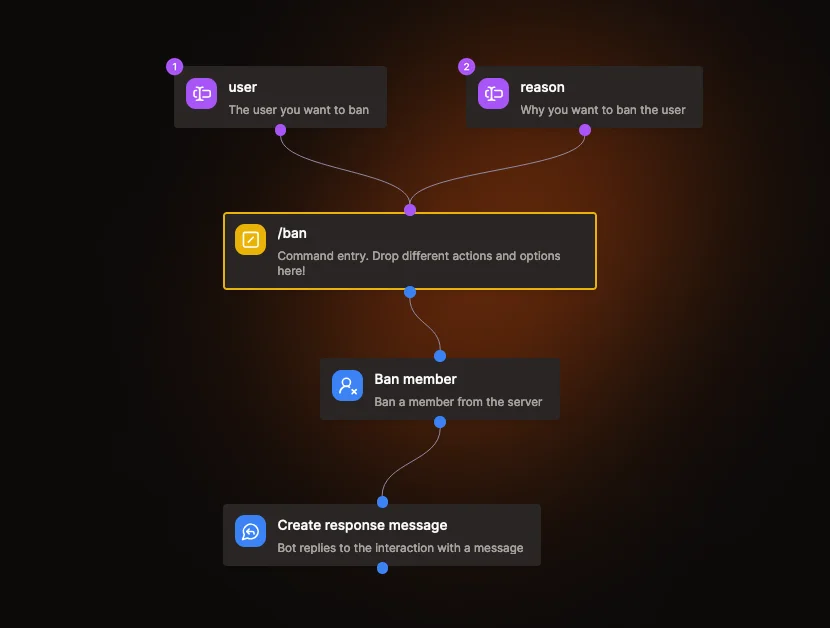

# Kite documentation

These docs explain how to build a Discord bot with Kite, from creating your app to the details of every block.

Kite is under active development, and new blocks and integrations are added regularly. The source code is on [GitHub](https://github.com/merlinfuchs/kite), and you can ask questions in the [Discord server](https://discord.gg/rNd9jWHnXh).

## What's Kite?

Kite is an open source platform for building and hosting Discord bots without writing code. You build commands and event listeners by connecting blocks in a visual editor, and Kite keeps your bot online 24/7. Each app you create in Kite is your own Discord bot, with its own name and avatar.

To make your first app, follow [Getting started](/guides/getting-started).

