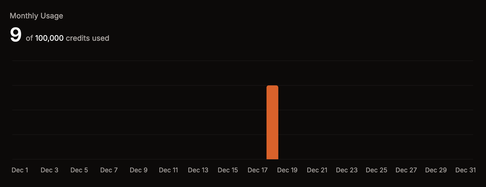

# Credit System

Kite is free to use, but we do have a credit system in place to prevent abuse. Most actions taken by your app in flows will consume [a set amount](#cost-breakdown) of credits.

By default, your app has **10,000 credits available per month**. This is usually more than enough for most apps. You can always subscribe to one of the **Premium** plans to get more credits.

To see if that's enough before you build anything, use the calculator on the [pricing page](https://kite.onl/pricing). Pick the templates your bot would use and the size of your server, and it estimates the credits for a month.

You can track your credit usage on the dashboard in the Monthly Usage section. After three full days of use in a month, it also shows how many credits your app will have used by the end of the month at its rate of the last week, or the day it runs out of them if that comes first.

Once your app has used 80% of its credits, the dashboard warns you. When it has used all of them, Kite stops it and your bot goes offline. It starts again by itself within a few minutes after the next month begins, which is the 1st at midnight UTC, or after you upgrade to a plan with more credits.

## Cost Breakdown

Credits pay for what your flows do, not for what they look up. Most actions in flows will consume **1 credit per execution** with a few exceptions:

- **`Ask AI` block**:
  - Fast (default): 5 credits per execution
  - Balanced: 20 credits per execution
  - Smartest: 100 credits per execution
- **`Search The Web` block**:
  - Fast (default): 25 credits per execution
  - Balanced: 100 credits per execution
  - Smartest: 500 credits per execution
- **`Send API request` block**: 3 credits per execution
- **Blocks that only read**: free. That's `Get stored variable` and the blocks that get a server, channel, role, member, user or message, or list messages. Reading from other services, like `Get ER:LC server`, still costs 1 credit.

Control flow blocks, like conditions and loops, will not consume any credits, except `AI Choice` and `AI Check`, which cost 1 credit like `AI Score`.

## Estimating Usage

The flow editor shows the most credits one run of the flow can cost at the top, next to `Ask AI`. It counts one branch of each condition and leaves out what buttons run, since they run when they're clicked. Templates show the same for each of their commands and event listeners, and what that adds up to at 100, 500 and 2,000 runs a month.

An event listener for messages or reactions runs for every one of them in your servers. When it costs credits even for the ones it has nothing to do for, the editor warns you. Add an event filter, or a condition before the first block that costs credits.

## Tips

Since most actions in your flows consume credits, it’s important to run actions only when necessary. For example, you should usually not run actions on every message. Instead, you should use conditions to only run actions when certain conditions are met.
