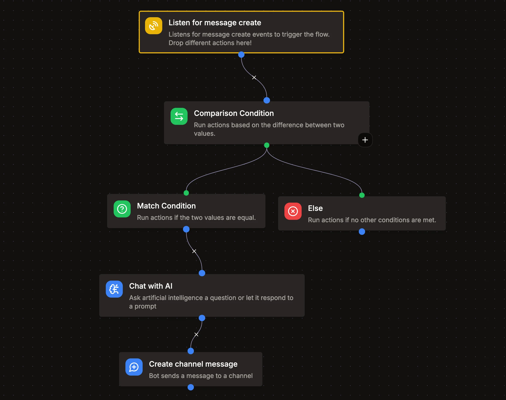

# Event Listener

With Event Listeners you can listen for events inside the Discord servers that your bot is in. They can also run on a [schedule](#scheduled-event-listeners) or when a [webhook](#webhook-event-listeners) is called. You find each kind on its own page under **Event Listeners** in the sidebar: **Discord Events**, **Scheduled Tasks** and **Webhooks**. Right now, Kite supports the following Discord events:

- Message Create
- Message Update
- Message Delete
- Direct Message Received
- Member Join
- Member Leave
- Reaction Add
- Reaction Remove
- Bot Joined Server
- Bot Left Server
- Server Boost
- Audit Log Entry

## Restrictions

- By default, your app is limited to 5 Discord events. Scheduled tasks and webhooks each have their own limit.
- Kite will ignore messages that are sent by a bot.
- Reaction events ignore reactions added or removed by your own app, so a flow that reacts to a message doesn't trigger itself. Reactions by other bots still fire the event.
- Reaction events provide the emoji as `{{emoji}}`, with `{{emoji.id}}`, `{{emoji.name}}` and `{{emoji.mention}}`. `{{emoji.id}}` is empty for unicode emojis.
- Reaction Remove only knows the user's ID, so only `{{user.id}}`, `{{user.mention}}` and `{{user.created_at}}` are available there. Fields like `{{user.username}}` are empty; use a Get User block if you need them.
- Member events are only available when you enable the "Server Members Intent" in the [Discord Developer Portal](https://discord.dev).
- Bot Left Server only provides `{{guild.id}}`, as the bot no longer knows anything else about the server.
- Discord doesn't say what a deleted message contained, so Message Delete gets `{{message.content}}` and the author as `{{user}}` from messages Kite saw before. That works for messages sent while your app was online, among the last 100 messages of each channel. For other messages only `{{message.id}}`, `{{channel}}` and `{{guild}}` are known. The content also needs the "Message Content Intent".
- The deleted message and its author stay available after the flow waits, e.g. as `{{origin.message.content}}` and `{{origin.user}}` after a button click. An Event Filter on the user ID compares with the author.
- Messages deleted in bulk, like with the Bulk delete messages block, don't run Message Delete.
- Message Update only runs for edits, not when Discord adds a link preview or the message is pinned. For a message edited before your app was last online, Kite can't tell the first of those apart from an edit.
- Direct Message Received triggers when a user sends a direct message to the bot. Message Create, Update and Delete only trigger for messages in servers, never for direct messages.
- Server Boost runs when a member boosts the server. `{{user}}` is the member who boosted, `{{guild}}` is the server, and `{{message.id}}` and `{{channel.id}}` are the boost message and the channel it was posted in.
- Kite detects boosts through the message Discord posts in the server's system messages channel. Server Boost only works when "Send a message when someone boosts this server" is enabled in the server settings and your bot can see that channel. It doesn't need the "Server Members Intent".



## Audit Log Entry

Audit Log Entry runs when something is added to a server's audit log, like a ban, a kick, a timeout, a role change or a channel change. Use it for moderation and server logs. Your bot needs the **View Audit Log** permission in the server, or Discord doesn't send it the entries.

It runs for every kind of action, so add an [Event Filter](./blocks/options/option_event_filter.md) with the target **Audit Log Action** and pick the actions the flow is for. Entries that are filtered out don't use credits.

| Placeholder                                                   | Value                                                                                                                    |
| ------------------------------------------------------------- | ------------------------------------------------------------------------------------------------------------------------ |
| `{{audit_log.action}}`                                        | The action, like `member_ban_add`                                                                                        |
| `{{user}}`                                                    | Who did it                                                                                                               |
| `{{audit_log.target}}`                                        | The member, role or channel the action was done to, as a mention                                                         |
| `{{audit_log.target_id}}`                                     | The ID of what the action was done to                                                                                    |
| `{{audit_log.reason}}`                                        | The reason, if one was given                                                                                             |
| `{{audit_log.changes}}`                                       | What changed, one setting per line, like `name: general → chat`                                                          |
| `{{audit_log.roles_added}}` and `{{audit_log.roles_removed}}` | The names of the roles added to or removed from a member                                                                 |
| `{{audit_log.timeout_until}}`                                 | When a timeout ends as a Unix timestamp. Put it into `<t:{{audit_log.timeout_until}}:R>` to show it like "in 10 minutes" |
| `{{channel}}`                                                 | The channel the entry is about, for channel changes and deleted or pinned messages                                       |

- Your app's own actions don't run it, so a flow that edits a channel doesn't trigger itself.
- Discord logs timeouts as member updates. Kite calls them `member_timeout_add` and `member_timeout_remove`, so they can be picked on their own. A timeout that runs out by itself isn't logged.
- Messages deleted by their author aren't in the audit log. Use Message Delete for those.
- `{{user}}` only has the ID and mention of members Kite hasn't seen in the server since your app connected. Use a Get Member block if you need more.

### Actions

These are the actions the Event Filter can pick, and the value `{{audit_log.action}}` has for them. When the target is a member, role or channel, `{{audit_log.target}}` mentions it. For other actions it's the ID of what was changed, like the webhook or the emoji.

| `{{audit_log.action}}`                        | In the Event Filter            | Target                |
| --------------------------------------------- | ------------------------------ | --------------------- |
| `member_ban_add`                              | Member Banned                  | Member                |
| `member_ban_remove`                           | Member Unbanned                | Member                |
| `member_kick`                                 | Member Kicked                  | Member                |
| `member_timeout_add`                          | Member Timed Out               | Member                |
| `member_timeout_remove`                       | Member Timeout Removed         | Member                |
| `member_role_update`                          | Member Roles Changed           | Member                |
| `member_update`                               | Member Updated                 | Member                |
| `member_prune`                                | Members Pruned                 | None                  |
| `member_move`                                 | Member Moved in Voice          | None                  |
| `member_disconnect`                           | Member Disconnected from Voice | None                  |
| `bot_add`                                     | Bot Added                      | The bot               |
| `message_delete`                              | Message Deleted by Moderator   | Author of the message |
| `message_bulk_delete`                         | Messages Bulk Deleted          | Channel               |
| `message_pin`                                 | Message Pinned                 | Author of the message |
| `message_unpin`                               | Message Unpinned               | Author of the message |
| `channel_create`                              | Channel Created                | Channel               |
| `channel_update`                              | Channel Updated                | Channel               |
| `channel_delete`                              | Channel Deleted                | Channel               |
| `channel_overwrite_create`                    | Channel Permission Added       | Channel               |
| `channel_overwrite_update`                    | Channel Permission Updated     | Channel               |
| `channel_overwrite_delete`                    | Channel Permission Removed     | Channel               |
| `thread_create`                               | Thread Created                 | Channel               |
| `thread_update`                               | Thread Updated                 | Channel               |
| `thread_delete`                               | Thread Deleted                 | Channel               |
| `role_create`                                 | Role Created                   | Role                  |
| `role_update`                                 | Role Updated                   | Role                  |
| `role_delete`                                 | Role Deleted                   | Role                  |
| `guild_update`                                | Server Updated                 | ID                    |
| `invite_create`                               | Invite Created                 | None                  |
| `invite_delete`                               | Invite Deleted                 | None                  |
| `webhook_create`                              | Webhook Created                | ID                    |
| `webhook_update`                              | Webhook Updated                | ID                    |
| `webhook_delete`                              | Webhook Deleted                | ID                    |
| `emoji_create`                                | Emoji Created                  | ID                    |
| `emoji_update`                                | Emoji Updated                  | ID                    |
| `emoji_delete`                                | Emoji Deleted                  | ID                    |
| `sticker_create`                              | Sticker Created                | ID                    |
| `sticker_update`                              | Sticker Updated                | ID                    |
| `sticker_delete`                              | Sticker Deleted                | ID                    |
| `guild_scheduled_event_create`                | Server Event Created           | ID                    |
| `guild_scheduled_event_update`                | Server Event Updated           | ID                    |
| `guild_scheduled_event_delete`                | Server Event Deleted           | ID                    |
| `auto_moderation_block_message`               | AutoMod Blocked a Message      | Member                |
| `auto_moderation_flag_to_channel`             | AutoMod Flagged a Message      | Member                |
| `auto_moderation_user_communication_disabled` | AutoMod Timed Out a Member     | Member                |
| `auto_moderation_rule_create`                 | AutoMod Rule Created           | ID                    |
| `auto_moderation_rule_update`                 | AutoMod Rule Updated           | ID                    |
| `auto_moderation_rule_delete`                 | AutoMod Rule Deleted           | ID                    |

Rarer actions, like onboarding or soundboard changes, also run the event. Their `{{audit_log.action}}` is Discord's name of the action in lowercase, like `soundboard_sound_create`. Actions Discord added after Kite are given as their number.

## Placeholders

The placeholder picker only lists the placeholders the event fills in. For example, Member Join has `{{user}}` and `{{guild}}`, but no channel or message.

## Scheduled Event Listeners

Scheduled event listeners don't wait for something to happen in Discord. They run their flow on a schedule, which you define with a [cron expression](https://crontab.guru). Schedules always use UTC.

| Schedule       | Runs                       |
| -------------- | -------------------------- |
| `*/5 * * * *`  | Every five minutes         |
| `0 * * * *`    | At the start of every hour |
| `0 18 * * 1-5` | At 18:00 UTC on weekdays   |

A scheduled run has no user, server or channel. Blocks that act on a server, like banning a member, need a target guild, and messages need a target channel. Response blocks only work after a button or select menu on a message the flow sent, as there's nothing to respond to before. The time the run was scheduled for is available as `{{schedule.time}}` and `{{schedule.unix}}`.

If Kite was down when a run was due, it catches up on the latest missed run if it's at most 5 minutes late. Older runs are skipped. A run is also skipped if the previous run of the same listener is still going.

### Restrictions

- Scheduled tasks have their own limit, 5 by default.
- By default, a schedule can run at most once every 5 minutes. [Premium](./premium.md) apps can run schedules once a minute.
- Every run uses credits like any other flow, so frequent schedules add up quickly. The editor shows an estimate of the credits a schedule uses per month.

## Webhook Event Listeners

Webhook event listeners run their flow when another service sends a request to their webhook URL. Use them to bring things that happen outside of Discord into your server, like a push on GitHub, a new video, a payment or a status alert.

To create one, select **Webhook** as the source of a new event listener. Open the settings of the first block in the flow editor to copy its webhook URL, or use **Copy Webhook URL** in the menu of the event listener. Then enter the URL wherever the other service asks for a webhook URL.

The URL only accepts `POST` requests. Kite answers with status `202` right away and runs the flow in the background. To return data to the sender, or reject a request with a status like `401`, add a [Respond to webhook](./blocks/actions/action_webhook_response_create.md) block. The request then waits until the flow responds or ends, and the flow keeps running after it responded.

You can try it from a terminal:

```shell
curl -X POST "YOUR_WEBHOOK_URL?source=test" \
  -H "Content-Type: application/json" \
  -d '{"repository": {"name": "kite"}}'
```

### Placeholders

| Placeholder                             | Value                                                     |
| --------------------------------------- | --------------------------------------------------------- |
| `{{webhook.body}}`                      | The body of the request as text                           |
| `{{webhook.data.repository.name}}`      | A field of the body parsed as JSON, `kite` in the example |
| `{{webhook.headers['x-github-event']}}` | A header of the request, header names are in lowercase    |
| `{{webhook.query.source}}`              | A query parameter of the URL, `test` in the example       |

Many services send different kinds of events to the same URL and name the kind in a header or in the body. Use a Comparison Condition block on that value to only react to the events you want.

Like a scheduled run, a webhook run has no user, server or channel. Blocks that act on a server need a target guild, and messages need a target channel. Response blocks only work after a button or select menu on a message the flow sent, as there's no interaction to respond to before.

### Verifying requests

Many services sign their requests, so you can check that a request really comes from them. Add a [Verify webhook signature](./blocks/controls/control_webhook_verify.md) block at the start of the flow, and answer its invalid branch with status `401`. Services that only send a token, like in an `Authorization` header, can be checked with a [Comparison Condition](./blocks/controls/control_condition_compare.md) against a [secret](./secrets.md).

### Keeping the URL secret

Anyone who knows the webhook URL can run the flow, and every run uses credits. Treat the URL like a password. If it got out, regenerate it in the settings of the first block. The old URL stops working right away and the new one works within a few seconds. Enter it wherever the old one was used.

The URL isn't part of the flow, so it isn't included when you export, share or duplicate the event listener. A copy gets its own URL.

### Restrictions

- Webhooks have their own limit, 5 by default.
- The body of a request can be up to 64 KB, and its headers and query parameters up to 16 KB together.
- All webhook event listeners of an app share a limit of 10 requests per minute, with bursts of up to 60 at once. Requests above that are answered with status `429` and don't run the flow.
- Requests are answered with status `404` while the event listener is disabled, and with `503` while your app is offline.
- A request to a flow with a Respond to webhook block waits up to 10 seconds, or until the flow ends, then it's answered with status `202`.
- It can take a few seconds until a new or re-enabled event listener accepts requests.
