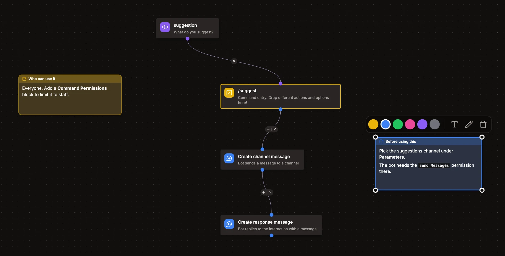

# Notes

Notes are text you put on the canvas of the editor, next to your blocks, to explain what a flow does: why a condition is there, which channel a parameter should be, or what to change before using it. They're saved with the command, event listener or button, so everyone who opens it sees them, and they come along when you export or share a flow.

Notes never run. They aren't blocks, nothing connects to them, and they don't cost credits.

## Adding a note

Click the note button in the controls at the bottom right of the editor, or in the bar at the bottom on mobile. You can also right click the canvas and pick _Add note_ to add one right there. You can start writing right away.

## Editing a note

- Double-click a note, or select it and click the pencil, to write in it. Click outside of it or press `Esc` to finish.
- Double-click its title, or select it and click the text button, to rename it. Notes are called _Note_ until you do.
- Drag a note to move it, and drag its corners or edges to resize it.
- Pick a color in the bar above a selected note, for example to tell notes for different parts of a flow apart.
- Delete a note with the trash button, or select it and press `Delete`.

Notes support the markdown you know from Discord: `**bold**`, `*italic*`, `__underline__`, `~~strikethrough~~`, `` `code` ``, code blocks, headings, bulleted and numbered lists, quotes and links. A note can be up to 2000 characters long and its title up to 100.

Auto arrange leaves notes where you put them and only moves them out of the way if the arranged blocks would cover them. Undo and redo work for notes like for blocks, and notes can be copied and pasted along with blocks.

The [Flow AI](../guides/flow-ai.md) reads your notes to understand the flow, but doesn't change them.
