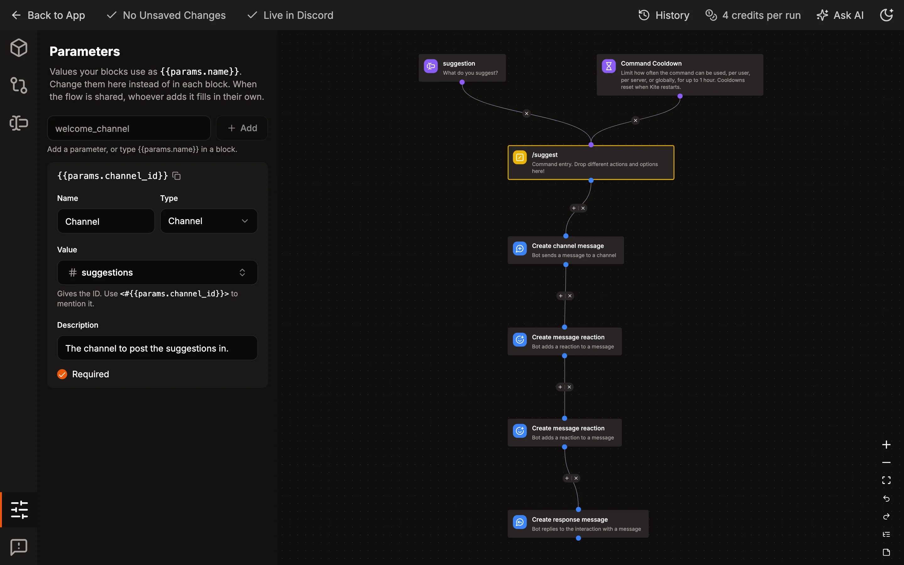

# Parameters

Parameters are values a flow uses in several places, like the channel it logs to. Write `{{params.NAME}}` in a block instead of the value, for example `{{params.log_channel}}` as the channel of a [Create channel message](./blocks/actions/action_message_create.md) block, and set the value once under _Parameters_ in the sidebar of the editor. Changing it there changes every block that uses it.

A parameter shows up in the sidebar as soon as a block uses it. Give it a name and a type there: text, long text, a channel or a role. New parameters are required, untick it for one that can stay empty. The _Parameters_ icon shows how many required parameters have no value yet. Blocks get an empty value for them, so a channel or role left empty makes the block fail. Channels and roles are picked from a server your bot is in, and their ID is the value. Names start with a letter or underscore and can contain letters, numbers and underscores. Each command, event listener and button has its own parameters, so `{{params.log_channel}}` in one command doesn't change another.

When you export a flow or [share several items](./templates.md#sharing-commands-event-listeners-and-message-templates), the values aren't part of it, they belong to your server. Whoever adds it fills in their own, and flows that use the same parameter get the same value. Give a parameter a description to tell them what it's for. Required ones have to be filled in.

[Templates](./templates.md) use parameters too. The values you pick when adding a template are the values of its parameters, and you can change them later in the sidebar of each command or event listener.

The buttons of messages that were already sent use the values the message template has now, so changing a parameter of a button flow also changes what buttons in Discord do. Their blocks stay the ones they were sent with, send the message again to update those.

Parameters also work in the value of an [Event Filter](./blocks/options/option_event_filter.md), for example `{{params.staff_role}}` to only run for members with a role. They don't work in the content of message templates yet.
